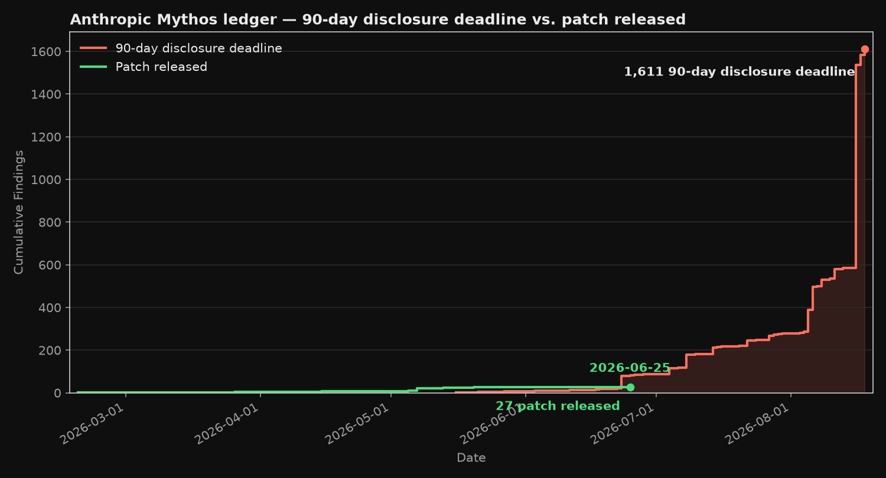
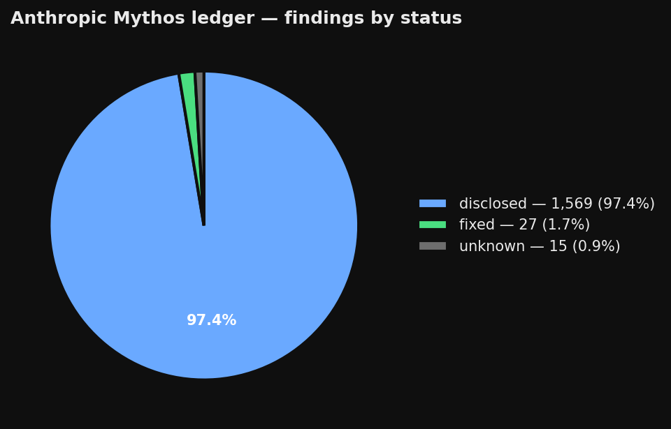

This project tracks anthropics findings reported on the [Anthropic disclosure ledger](https://red.anthropic.com/2026/cvd/ledger/) for research purposes. It collects data from the ledger and generates several data formats including csv and json along with a changelog from each run.

<!-- METRICS:START -->
**Days since last change:** 30 | **Days since last addition:** 36

| Metric | Findings |
| :--- | :---: |
| Findings added (all-time) | 1,611 |
| Findings added (last 7 days) | 0 |
| Findings fixed | 27 |
<!-- METRICS:END -->

<!-- DEADLINES:START -->
| Disclosure deadline | Findings |
| :--- | :---: |
| Past 90-day deadline — revealed | 1 |
| Past 90-day deadline — not yet revealed | 79 |
| Due in the next 1 day | 4 |
| Due in the next 3 days | 7 |
| Due in the next 7 days | 8 |
| Due in the next 30 days | 168 |
<!-- DEADLINES:END -->

