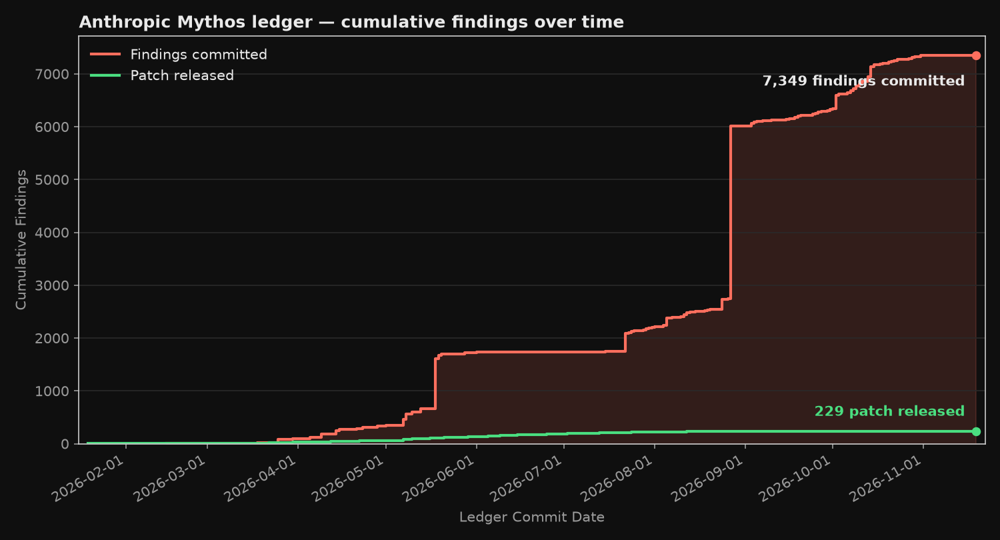

This project tracks anthropics findings reported on the [Anthropic disclosure ledger](https://red.anthropic.com/2026/cvd/ledger/) for research purposes. It collects data from the ledger and generates several data formats including csv and json along with a changelog from each run.

<!-- METRICS:START -->
|  | Findings added | Findings fixed | Findings changed |
| :--- | :---: | :---: | :---: |
| **All-time** | 1,611 | 27 | 15 |
| **Last 7 days** | 1,611 | 27 | 15 |

| Days since last change | Days since last addition |
| :---: | :---: |
| 3 | 9 |
<!-- METRICS:END -->

<!-- DEADLINES:START -->
| Disclosure deadline | Findings |
| :--- | :---: |
| Reached — not yet revealed | 7 |
| Reached — revealed | 0 |
| Due within 1 day | 1 |
| Due within 3 days | 1 |
| Due within 7 days | 2 |
| Due within 30 days | 80 |
<!-- DEADLINES:END -->

